<!-- ========== HERO (switches with the viewer's light/dark mode) ========== -->
<p align="center">
  <picture>
    <source media="(prefers-color-scheme: dark)" srcset="assets/header-dark.svg" />
    <source media="(prefers-color-scheme: light)" srcset="assets/header-light.svg" />
    
  </picture>
</p>

<!-- ========== NEON SOCIAL BUTTONS ========== -->
<p align="center">
  <a href="https://linkedin.com/in/YOUR_LINKEDIN"></a>
  <a href="mailto:YOUR_EMAIL"></a>
  <a href="https://github.com/slayplayagrima"></a>
  <a href="https://parsemind.vercel.app"></a>
  <a href="https://leetcode.com/YOUR_LEETCODE"></a>
</p>

<!-- ========== GALAXY GRID (4 clickable quadrants around one planet) ========== -->
<p align="center">
  <a href="https://github.com/slayplayagrima/ParseMind"></a><a href="https://platform.worldquantbrain.com"></a><br/><a href="https://github.com/slayplayagrima/LeetGitSync"></a><a href="https://linkedin.com/in/YOUR_LINKEDIN"></a>
</p>

<p align="center">
  
  
  
</p>

---

## 🪐 About Me

```python
class Agrima:
    def __init__(self):
        self.username  = "slayplayagrima"
        self.location  = "Delhi, India 🇮🇳"
        self.education = "B.Tech CS & Technology @ Newton School of Technology (Rishihood University), 2024–2028"
        self.roles     = ["AI/ML Engineer", "Full-Stack Developer", "Quant Researcher"]
        self.focus     = ["GenAI & AI Agents", "Deep Learning", "Forecasting", "Data Analytics"]
        self.quant     = "Quantitative Finance — Gold Level on WorldQuant BRAIN 🥇"
        self.led       = "Team Lead — Smart India Hackathon (SIH)"
        self.freelance = "Full-stack & AI developer for a B2B procurement startup"

    def motto(self):
        return "Ship it, measure it, make it better."
```

---

## 🌌 Tech Universe

**Languages**
<p align="left"></p>

**Web & Backend**
<p align="left"></p>

**AI / ML & Deep Learning**
<p align="left"></p>
<p align="left">
  
  
  
  
</p>

**Data Science & Analytics**
<p align="left">
  
  
  
  
  
</p>

**DevOps**
<p align="left"></p>

---

## 🚀 Experience

**Freelance Full-Stack & AI Developer — Market Procurement Intelligence (MPI)**
*AI-powered B2B procurement platform connecting startups with verified MSMEs*
- Took over an existing React + TypeScript + Supabase codebase and audited it end to end (architecture, security, UX)
- Leading the work to a client-ready MVP: secure auth and roles, the RFQ → quote → award flow, and a server-side AI integration
- Manage the technical handover of code, hosting and database to the client's own accounts

---

## ✨ Projects in Orbit

| Project | What it does | Stack |
|---|---|---|
| 📄 **[ParseMind](https://github.com/slayplayagrima/ParseMind)** · [Live](https://parsemind.vercel.app) | AI-powered document intelligence platform for contracts and resumes | GenAI · LLMs · React · Python |
| 💧 **[JalNetra](https://github.com/slayplayagrima/JalNetra)** | *One-line description of JalNetra* | *Stack* |
| 🔁 **[LeetGitSync](https://github.com/slayplayagrima/LeetGitSync)** | Browser extension that syncs LeetCode solutions to GitHub | JavaScript · Chrome Extension · GitHub API |
| 🚨 **[Crime Forecasting & Trend Analysis](https://github.com/slayplayagrima/Crime-Forecasting)** | Forecasting and analysing crime trends over time | Python · Time Series · Pandas · Matplotlib |
| 💰 **[Income Insights & Prediction](https://github.com/slayplayagrima/Income-Insights)** | Exploratory analysis and income prediction modelling | Python · scikit-learn · Pandas · Seaborn |

---

## 📡 Signals from My GitHub

<p align="center">
  
  
</p>

<p align="center">
  
</p>

<p align="center">
  
</p>

---

## ☄️ Contribution Snake

<p align="center">
  <picture>
    <source media="(prefers-color-scheme: dark)" srcset="https://raw.githubusercontent.com/slayplayagrima/slayplayagrima/output/github-contribution-grid-snake-dark.svg" />
    
  </picture>
</p>

<p align="center"></p>
