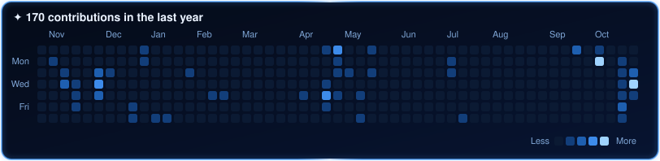

<!-- ========== HERO (switches with the viewer's light/dark mode) ========== -->

  <picture>
    <source media="(prefers-color-scheme: dark)" srcset="assets/header-dark.svg" />
    <source media="(prefers-color-scheme: light)" srcset="assets/header-light.svg" />
    
  </picture>

<!-- ========== BLUE SECTION PANELS ========== -->

  

  
  

  

  <picture>
    <source media="(prefers-color-scheme: dark)" srcset="https://raw.githubusercontent.com/slayplayagrima/slayplayagrima/output/github-contribution-grid-snake-dark.svg" />
    
  </picture>

  <b>Thanks for visiting my corner of the universe ✦</b> 
  Ship it · measure it · make it better  
  

